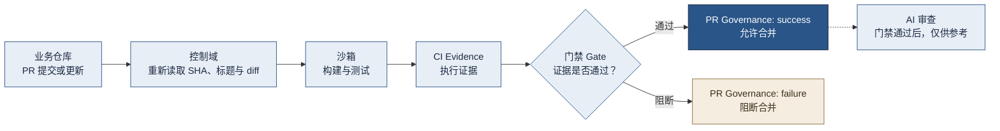
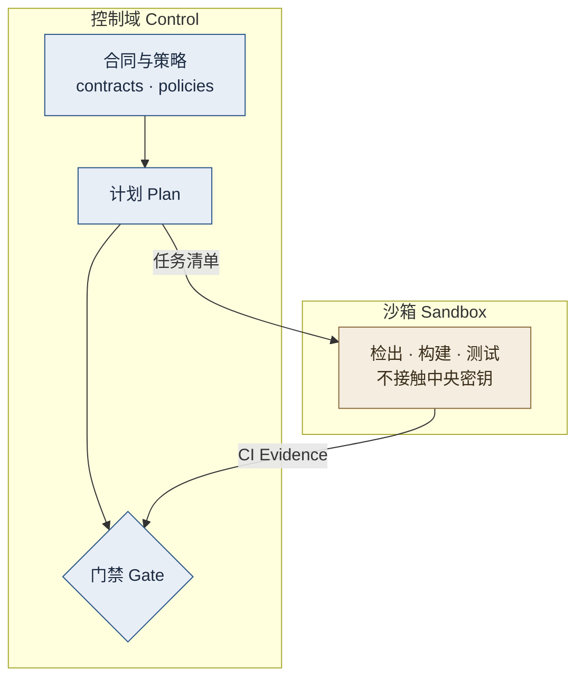

<div align="center">

# Action Worker

Fongap Labs 的中央 GitHub 自动化控制平面统一负责任务分发、PR 治理、AI 审查、发布治理与部署治理。

<!-- work-metrics:start -->
[](https://github.com/fongap-labs/action-worker/actions) [](https://github.com/fongap-labs/action-worker/actions) [](https://github.com/fongap-labs/action-worker/actions) [](https://github.com/fongap-labs/action-worker/releases) [](https://github.com/fongap-labs/action-worker/actions/workflows/validate-ci.yml)
<!-- work-metrics:end -->

[快速开始](#快速开始) · [接入指南](docs/05_INTEGRATION_GUIDE.md) · [维护者参考](#维护者参考) · [安全策略](SECURITY.md)

</div>

> 新手请从 **这是什么** 读到 **快速开始**；维护者可直接跳到 [维护者参考](#维护者参考)。

## 新手学习路径

| 阶段 | 目标 | 必读文档 | 预计时间 |
| --- | --- | --- | --- |
| 入门 | 理解定位与核心流程 | README 全文、[01_SHARED_GOVERNANCE](docs/01_SHARED_GOVERNANCE.md) | 30 min |
| 接入 | 让业务仓库跑通 PR Governance | [05_INTEGRATION_GUIDE](docs/05_INTEGRATION_GUIDE.md) | 1 h |
| 开发 | 在本地跑通类型/测试/门禁 | [DEVELOPMENT_GUIDE](docs/DEVELOPMENT_GUIDE.md) | 2 h |
| 发布 | 完成一次受管发布 | [架构文档 §13](docs/ARCHITECTURE.md#13-部署治理) | 1 h |

## 这是什么

Action Worker 是 Fongap Labs 的**中央质检站**，为所有受管仓库（接入统一治理的业务仓库）服务。仓库只声明"要检查什么"，质检站自行拉取代码、运行检查、留下证据，最后由**门禁**（Gate，决定放行或阻断的检查）给出结论。

| 能力 | 解决的问题 |
|---|---|
| **PR 治理** | PR 能否合并由确定性门禁决定，AI 只提供参考 |
| **任务分发** | 把任务安全地交给中央执行，业务仓库不接触中央密钥 |
| **AI 审查** | 门禁通过后给出建议，不能改写门禁结论 |
| **发布治理** | 统一版本号、产物校验与回滚 |
| **部署治理** | 只有可信的 `main` 提交才能进入部署 |

## 一个例子

一个 PR 从提交到结论，经过的路径如下：



门禁阻断时，合并被拦下；门禁通过后，AI 审查才会异步给出参考意见。

## 快速开始

### 接入一个业务仓库

接入分三步。完成后，每个 PR 打开或推送新提交时，都会出现 `PR Governance` 状态检查；`main` 的每次 push 都会立即唤醒 Action Worker 的 Intake（中央 CI、main 写入证明、变更任务）。

| 步骤 | 位置 | 操作 |
|---|---|---|
| 1 | 业务仓库 | 新建 `.github/workflows/notify-action-worker.yml`，内容与[标准模板](templates/bridge/notify-action-worker.yml)逐字节一致；这是业务仓库中唯一需要的 Action Worker 工作流 |
| 2 | 业务仓库的 Secrets | 配置 `AW_DISPATCH_TOKEN`，它只允许向 `action-worker` 发送分发事件 |
| 3 | Action Worker 的仓库变量 | 在 `AW_REPOSITORY_POLICY` 中登记仓库及其能力 |

<details>
<summary><strong>⚙️ AW_DISPATCH_TOKEN 最小权限配置（点击展开）</strong></summary>

- **令牌类型**：GitHub Fine-grained Personal Access Token（建议用专用机器人账号签发）
- **资源所有者**：选择拥有 `action-worker` 仓库的组织/账号
- **仓库访问**：仅勾选 `fongap-labs/action-worker`
- **权限**（最小集）：
  - `Actions` → `Read`（触发 workflow_dispatch）
  - `Metadata` → `Read`（读取仓库基础信息）
  - `Repository variables` → `Read`（读取 `AW_REPOSITORY_POLICY`）
- **过期时间**：建议 90 天，到期前轮换
- **说明**：此令牌**不需要** `Contents`、`Administration`、`Deployments` 等高权限

</details>

> ⚠️ **硬性门禁**：PR 合并**唯一**取决于 `validate-merge` 通过；`main` 仅接受 Squash merge 且来源经 `Main Write Guard` 校验。AI Review、**仅供参考**，不具备放行权。

#### 第 3 步示例

`AW_REPOSITORY_POLICY` 的值为 JSON 字符串，例：

```json
{
  "fongap-labs/example": ["pr", "task"]
}
```

| 能力 | 授权内容 |
|---|---|
| `pr` | PR 治理 |
| `task` | 任务分发 |
| `release-source` | 作为发布构建的源码 |
| `release-target` | 作为发布的目标 |
| `deploy` | 解析部署清单 `.github/deploy.json` |

> 💡 **可选：启用自动部署** —— 在源仓库放置 `.github/deploy.json`，并在 `AW_REPOSITORY_POLICY` 中为该仓库追加 `deploy` 能力。完成后，受信 `main` 写入将自动触发部署。

### 常见问题

| 现象 | 排查 |
|---|---|
| PR 显示 `PR governance dispatch failed` | 打开该 PR 的 Actions 日志；若提示 `AW_DISPATCH_TOKEN is not configured.`，说明第 2 步未完成 |
| 没有任何 `PR Governance` 状态 | 确认第 1、3 步已完成，且仓库在 `AW_REPOSITORY_POLICY` 中拥有 `pr` 能力 |

> ⚠️ **模板安全提示**：标准模板使用 `pull_request_target` 触发器且**不 checkout PR 代码**、**不执行 PR 任何脚本**。请**严格保持模板逐字节一致**；任何修改都会引入供应链风险。Fork 来源的 PR **不会**触发此工作流（安全设计）。

## 进阶：Action Worker 如何工作



> 此图为控制域/沙箱职责分层视图，配合术语表阅读。计划可以动态变化，权限边界与门禁必须保持固定。

| 术语 | 含义 |
|---|---|
| **受管仓库** | 接入统一治理、在 `AW_REPOSITORY_POLICY` 中登记的业务仓库 |
| **Intake** | Action Worker 入口工作流（`intake.yml`），负责分发→中央 CI→Main Write Guard→变更任务→可选部署 |
| 分发（Dispatch） | 业务仓库发给质检站的"请处理"通知，只含仓库、PR 编号等标识，不含密钥 |
| 控制域（Control） | 可使用中央密钥，只读取证据并做决定，从不执行 PR 代码 |
| 沙箱（Sandbox） | 执行构建与测试，绝不接收中央密钥或部署凭据 |
| 计划（Plan） | 根据改动范围，决定需要运行哪些检查 |
| Main Write Guard | 主分支写入守卫，确认 `main` 上的提交来自合法的合并，只有可信提交才进入部署。详见 [主分支守卫](docs/07_MAIN_WRITE_GUARD.md)。 |
| 中央 CI（Central CI） | 在中央运行测试包并生成 CI Evidence 的检查环境。 |
| CI Evidence | 沙箱产生的执行记录，门禁只认可可验证的证据 |
| 门禁（Gate） | 唯一的合并许可：`validate-merge` 成功才放行 |
| 来源证明（provenance） | 记录产物由哪个不可变源码构建，供发布与部署核验 |

## 仓库结构

| 目录 | 内容 | 关键文件示例 |
|---|---|---|
| `.github/workflows/` | GitHub 入口，编排分发、门禁、发布与部署 | `intake.yml`, `validate-merge.yml`, `release.yml` |
| `contracts/` | 输入输出的机器合同 | `dispatch.json`, `evidence.json` |
| `policies/` | 确定性治理策略 | `pr-governance.rego`, `release-policy.rego` |
| `rules/` | AI 审查规则 | `review-rules.md` |
| `skills/` | 可复用的 Agent 执行技能 | `skills/README.md` |
| `scripts/` | 共用执行脚本 | `scripts/merge-guard.sh` |
| `tests/` | 治理与合同回归测试 | `tests/contracts.test.ts` |
| `tests/packs/` | 受管仓库的测试包 | `tests/packs/ai-gateway/`, `tests/packs/delta/` |
| `templates/` | 业务仓库的标准触发器模板 | `templates/bridge/notify-action-worker.yml` |
| `docs/` | 面向人与 Agent 的治理文档 | `docs/README.md` |

项目专属配置不属于 Action Worker，留在业务仓库中。

## 维护者参考

### 发布与部署


- 版本号只来自发布时手动输入的值，标签格式为 `<release-key>-v<semver>`。
- 部署由源仓库的 `.github/deploy.json` 声明，在可信的 `main` 写入后自动执行，详见 [架构文档](docs/ARCHITECTURE.md) 第 13 节。

### 文档

| 想了解 | 阅读 |
|---|---|
| 文档总索引 | [docs/README.md](docs/README.md) |
| 共用治理与权威顺序 | [docs/01_SHARED_GOVERNANCE.md](docs/01_SHARED_GOVERNANCE.md) |
| 架构与当前实现 | [docs/ARCHITECTURE.md](docs/ARCHITECTURE.md) |
| 受管仓库接入规范 | [docs/05_INTEGRATION_GUIDE.md](docs/05_INTEGRATION_GUIDE.md) |
| 开发与验证流程 | [docs/DEVELOPMENT_GUIDE.md](docs/DEVELOPMENT_GUIDE.md) |
| 变更分类与 CHANGELOG | [docs/04_CHANGELOG_CONVENTIONS.md](docs/04_CHANGELOG_CONVENTIONS.md) |
| Agent 入口 | [CLAUDE.md](CLAUDE.md)、[skills/README.md](skills/README.md) |

## 参与贡献

- 面向人的文档与 CHANGELOG 条目用中文；工程 diff 与 PR 标题用英文。
- PR 标题格式为 `type(scope): summary`，`type` 取值见 [CHANGELOG 约定](docs/04_CHANGELOG_CONVENTIONS.md)。
- `feat`、`fix`、`perf`、`revert` 与破坏性变更必须更新 `CHANGELOG.md`。
- 治理变更必须同时更新合同、策略与回归测试；仅有文档不构成约束。
- 不按仓库名分支，不新增 `projects/`、`adapters/`、`profiles/` 目录。
- 提交信息只署名提交者，不含任何 AI Agent 或工具署名。

### 本地检查

需要 Node.js 24 及以上（以 `package.json` 的 `engines.node` 为准）。提交前建议在本地运行：

| 命令 | 作用 |
|---|---|
| `npm ci` | 按锁文件安装依赖 |
| `npm run typecheck` | TypeScript 类型检查 |
| `npm run lint` | Biome 代码与格式检查 |
| `npm test` | 治理与合同测试 |
| `npm run check` | 依次执行以上三项检查 |

## 安全

请勿在公开 Issue 中披露漏洞。使用 GitHub 私密报告：**Security → Advisories → Report a vulnerability**。详见 [SECURITY.md](SECURITY.md)。

## 许可证

[Apache-2.0](LICENSE)
